# SubscriptIQ – SaaS Revenue, Customer Retention & Churn Analytics Platform

[](https://www.python.org/)
[](https://www.postgresql.org/)
[](https://www.getdbt.com/)
[-emerald.svg)](#medallion-architecture)
[](LICENSE)

An end-to-end SaaS Revenue and Customer Analytics Data Warehouse simulating an enterprise subscription business analytics ecosystem. Designed to solve real business challenges around Monthly Recurring Revenue (MRR), Customer Churn, Retention Cohorts, Customer Lifetime Value (CLV), Customer Acquisition Cost (CAC), and Payment Reliability.

---

## Executive Summary & Business Problem

Subscription software businesses (SaaS) generate continuous event streams across customer acquisition, recurring subscriptions, payment gateways, marketing campaigns, and customer support. However, fragmented source data leads to:

- Inaccurate MRR and ARR reporting due to inconsistent billing cycle definitions.
- Delayed churn identification and missed early warning signals for account cancellation.
- Inability to tie marketing campaign spend directly to retained subscription cohorts.
- High involuntary churn from unmonitored recurring payment gateway failures.

**SubscriptIQ** resolves these challenges by centralizing raw transactional streams into a structured **Medallion Data Warehouse** (Bronze, Silver, Gold) with star schema marts, automated ETL/ELT pipelines, machine learning churn risk scoring, and interactive business intelligence dashboards.

---

## Project Highlights

- **Synthetic Enterprise SaaS Dataset**: Relationally coherent dataset featuring 5,000+ customers, 8,000+ subscriptions, 20,000+ payment transactions, 5,000+ support tickets, and multi-touch marketing campaigns.
- **Medallion Data Warehouse Architecture**:
  - **Bronze Layer**: Raw transactional landing zone with ingestion audit metadata.
  - **Silver Layer**: Cleaned, deduplicated, validated, and normalized dimensional entities.
  - **Gold Layer**: Star schema analytical marts optimized for BI, cohort heatmaps, and executive reporting.
- **Full ELT / ETL Pipeline**: Modular Python + SQLAlchemy pipeline with dual-engine flexibility (PostgreSQL and zero-config local SQLite/DuckDB).
- **dbt Modeling & Data Quality**: Version-controlled SQL transformations, referential integrity tests, freshness, and schema documentation.
- **Predictive Churn Risk Analytics**: Transparent business-rule risk scoring combined with a Scikit-Learn churn prediction classifier.
- **Business Intelligence & Reporting**: 6-page dashboard specification, complete DAX calculation library, and standalone interactive HTML dashboard.

---

## Medallion Architecture Overview

```mermaid
flowchart TD
    subgraph Sources["Raw Data Sources"]
        S1["Customer Records"]
        S2["Subscriptions & Plans"]
        S3["Payment Transactions"]
        S4["Support Tickets"]
        S5["Marketing Campaigns"]
    end

    subgraph Bronze["Bronze Layer (Raw Ingestion)"]
        B1["bronze_customers"]
        B2["bronze_subscriptions"]
        B3["bronze_payments"]
        B4["bronze_support_tickets"]
        B5["bronze_marketing_campaigns"]
        B6["bronze_subscription_plans"]
    end

    subgraph Silver["Silver Layer (Cleaned & Conformed)"]
        S_dim_cust["silver_customers"]
        S_dim_plan["silver_subscription_plans"]
        S_fact_sub["silver_subscriptions"]
        S_fact_pay["silver_payments"]
        S_fact_supp["silver_support_tickets"]
        S_fact_mkt["silver_marketing_campaigns"]
    end

    subgraph Gold["Gold Layer (Analytics Marts & Star Schema)"]
        G1["gold_revenue_metrics (MRR, ARR, ARPU)"]
        G2["gold_customer_360 (Consolidated Profiles)"]
        G3["gold_churn_analysis (Voluntary vs Involuntary)"]
        G4["gold_retention_cohorts (Monthly Retention %)"]
        G5["gold_subscription_performance (Upgrades / Downgrades)"]
        G6["gold_marketing_performance (CAC & ROI)"]
        G7["gold_customer_lifetime_value (CLV Segments)"]
        G8["gold_payment_performance (Success vs Failure)"]
    end

    subgraph Consumers["Downstream Business Consumption"]
        BI["Power BI / Executive Dashboards"]
        ML["Churn Risk Scoring & ML Predictor"]
        REP["Business Insights & Executive Strategy"]
    end

    Sources --> Bronze
    Bronze --> Silver
    Silver --> Gold
    Gold --> Consumers
```



---

## Repository Structure

```text
subscriptiq-saas-analytics/
├── .github/workflows/          # Continuous integration workflows
├── config/                     # Database and runtime configuration
├── data/
│   ├── raw/                    # Raw ingested datasets
│   ├── processed/              # Normalized clean data
│   └── gold_exports/           # Power BI and reporting CSV exports
├── dbt_subscriptiq/            # dbt project (models, tests, documentation)
│   └── models/
│       ├── bronze/
│       ├── silver/
│       └── gold/
├── dashboard/                  # Power BI DAX measures, specifications, and interactive app
├── docs/                       # Architecture diagrams, BRD, data dictionaries, reports
├── sql/                        # Pure SQL DDL scripts, views, and analytical KPI queries
├── src/                        # Core Python source code
│   ├── data_generator/         # Synthetic SaaS data generation engine
│   ├── ingestion/              # Bronze layer raw ingestion
│   ├── transformation/         # Silver and Gold ELT transformation logic
│   ├── analytics/              # ML churn model, KPI calculations, retention engine
│   └── pipeline/               # Orchestration runner
├── tests/                      # Automated test suite
├── .env.example
├── LICENSE
├── requirements.txt
└── README.md
```

---

## Quickstart Guide

### 1. Clone the Repository
```bash
git clone https://github.com/Ankitabind12/subscriptiq-saas-analytics.git
cd subscriptiq-saas-analytics
```

### 2. Environment Setup
```bash
python -m venv venv
# Windows:
.\venv\Scripts\activate
# Linux/macOS:
source venv/bin/activate

pip install -r requirements.txt
cp .env.example .env
```

### 3. Run the End-to-End Pipeline
```bash
# Generates synthetic data, ingests Bronze, transforms Silver & Gold, runs ML & exports KPIs
python -m src.pipeline.run_pipeline
```

---

## Author & Contact

Developed as an end-to-end Data Engineering, Data Intelligence, and Business Analyst portfolio demonstration by **Ankita Bind**.
- GitHub: [https://github.com/Ankitabind12](https://github.com/Ankitabind12)
- Email: ankitabind12@gmail.com
